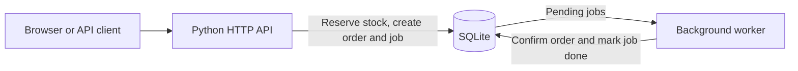
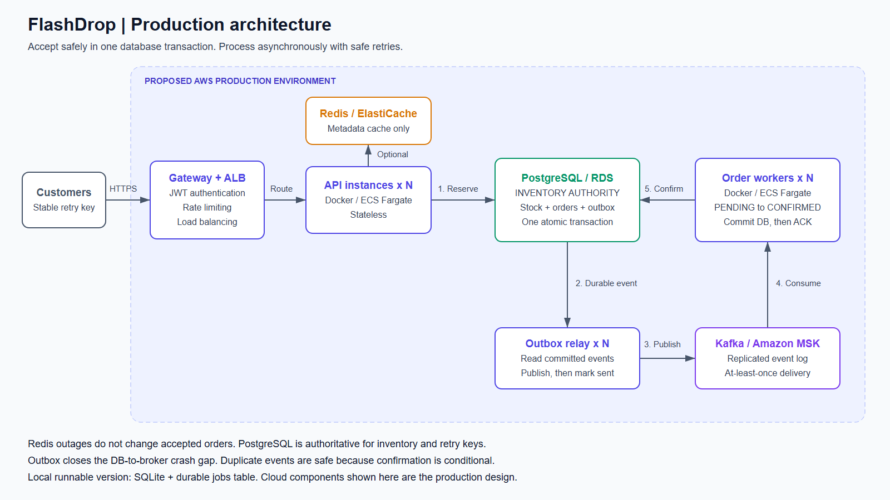
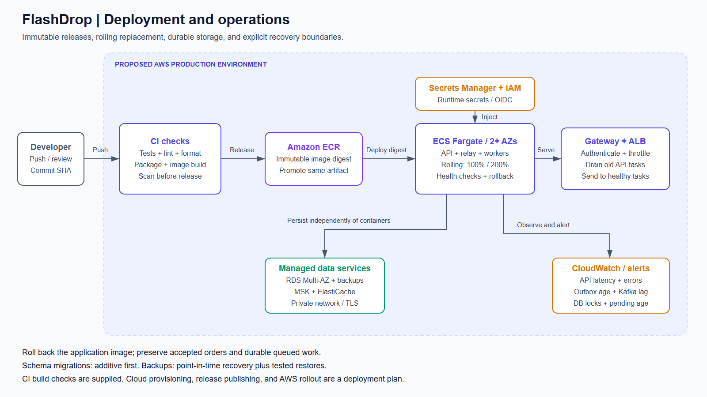

# FlashDrop

A flash-sale backend that reserves limited inventory, prevents duplicate orders on retries, and confirms orders asynchronously.

The runnable service uses **Python 3.12+, SQLite, and a durable jobs table**. It includes a small browser demo and has no third-party runtime dependencies. AWS, PostgreSQL, Redis, and Kafka are a separate production proposal, not services required to run this repository.

## Quick start

```sh
git clone https://github.com/khushi09-oss/flashdrop.git
cd flashdrop
python -m flashdrop
```

Open **http://localhost:8000**. Place an order, watch it become CONFIRMED, then select **Retry last request**. The retry returns the same order without reserving more stock.

For a terminal demonstration, run this in a second terminal:

```sh
python scripts/demo.py
```

A new database starts with 100 units of `iphone_16`. Orders consume real demo inventory, and restarts preserve it in `data/flashdrop.db`. To use a separate fresh database, start with `python -m flashdrop --db data/fresh.db`. Stop any other service using port 8000 first.

Run the automated checks from the repository root:

```sh
python -m unittest discover -v
```

See [verification and limits](docs/AUDIT.md) for the current results and [testing](docs/TESTING.md) for failure scenarios and the optional isolated load test.

## Implemented architecture



The API and worker run together by default. Separate processes can share the same database file on one host; independent files on different hosts cannot coordinate inventory.

One transaction checks the user's idempotency key, conditionally decrements stock, creates a PENDING order, and inserts a job. All changes commit together or roll back. The worker confirms the order and marks its job processed in a second transaction; it never deducts inventory again.

```sql
UPDATE products SET stock = stock - :quantity
WHERE id = :product_id AND stock >= :quantity;
```

Zero changed rows means reject the purchase. SQLite's `BEGIN IMMEDIATE` coordinates writers across processes, and constraints enforce nonnegative stock and unique `(user_id, idempotency_key)` values. [Architecture decisions and failure handling](docs/ARCHITECTURE.md) explain the tradeoffs.

## API

Set `Content-Type: application/json` and `X-User-Id: user_123` when creating an order. The identity header is a local demo mechanism, not authentication. It must match `userId`; order reads are filtered by that identity.

```json
{
  "userId": "user_123",
  "productId": "iphone_16",
  "quantity": 1,
  "idempotencyKey": "request_abc123"
}
```

| Request or condition | Response |
| --- | --- |
| `POST /orders` | 202 with `orderId` and `status: PENDING`; Location points to the order |
| Same user, key, and payload | Same acceptance; `Idempotency-Replayed: true` |
| Same user/key, changed product or quantity | 409 `IDEMPOTENCY_CONFLICT` |
| `GET /orders/:orderId` | 200 with current PENDING or CONFIRMED status; requires `X-User-Id` |
| Insufficient stock | 409 `OUT_OF_STOCK` |
| Invalid fields or quantity | 422 `VALIDATION_ERROR` |
| Malformed JSON or ambiguous field/length headers | 400 |
| Unknown product/order or another user's order | 404 |
| Missing identity / identity mismatch | 401 / 403 |
| `GET /products/iphone_16` | Current stock snapshot; not a reservation |
| `GET /health` | 200 if the inventory database can be read |
| Database busy or unavailable | 503; retry with the same key |

POST replays the original acceptance status; GET reports the latest status. Only accepted orders bind a key. Validation requires exactly the four documented fields, integer quantities from 1 to 10,000, and identifiers of 1-128 letters, digits, `.`, `:`, `_`, or `-`. Bodies are limited to 8 KiB.

## Docker

With Docker running:

```sh
docker compose up --build -d
```

Open the same browser URL or run the terminal demo. `docker compose down` stops the service and retains its named volume. Use either Docker or the Python server on port 8000, rather than starting both.

## Production proposal

The diagrams below show a proposed AWS deployment. The production HTTP adapter, JWT verification, PostgreSQL store, outbox relay, Kafka consumer, Redis cache, and cloud provisioning are not implemented here.





[Architecture explanation](docs/ARCHITECTURE.md) · [Deployment plan](docs/DEPLOYMENT.md) · Editable diagrams: [architecture](docs/architecture.drawio), [deployment](docs/deployment.drawio). SVG exports are in `docs/`. Open the `.drawio` files in [draw.io](https://app.diagrams.net).

## Scope and repository guide

PENDING means inventory is already reserved; CONFIRMED means the simulated background step completed. Payments, fulfillment, cancellation, restocking, expiration, and per-customer purchase limits are outside this exercise. Idempotency records are retained with orders indefinitely.

The local identity header, demonstration HTTP server, and single SQLite host are not a public production deployment. The measured load test uses bounded concurrency and does not establish capacity for 10,000 simultaneous connections.

| Location | Responsibility |
| --- | --- |
| `flashdrop/api.py`, `validation.py` | HTTP boundary and request validation |
| `flashdrop/store.py` | Schema, transactions, inventory, idempotency, and job processing |
| `flashdrop/worker.py`, `__main__.py` | Worker loop, startup, and shutdown |
| `flashdrop/static/` | Browser demo |
| `tests/` | HTTP, persistence, concurrency, process recovery, and optional load tests |
| `scripts/demo.py` | Terminal demonstration |
| `docs/` | Architecture, deployment, verification, and requirement coverage |

See [CONTRIBUTING.md](CONTRIBUTING.md) for the branch, commit, validation, and PR workflow, and [requirement coverage](docs/REQUIREMENTS.md) for the assessment mapping.
