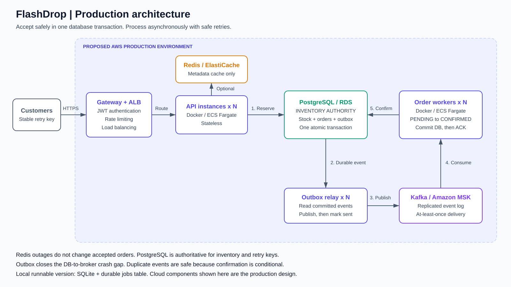

# Architecture

## Implemented system

```text
HTTP client → threaded Python API → SQLite transaction
                                    ├─ products: remaining inventory
                                    ├─ orders: request identity + status
                                    └─ jobs: durable pending work
Background worker ────────────────────────┘
```

Each operation opens its own connection. `BEGIN IMMEDIATE` takes the write lock before the key lookup and stock change. The transaction commits before the API sends 202. There is no in-memory inventory or queue to lose on a restart. The default rollback journal and `synchronous=FULL` provide durability subject to the filesystem and storage device honoring flushes.

The worker selects one unprocessed job, conditionally changes PENDING to CONFIRMED, and marks the job processed in the same transaction. Holding the transaction across these two short database statements is appropriate here. Never hold this database lock while making payment or other network calls.

## Production system



The [editable diagram](architecture.drawio) contains the same components and flows. Everything inside the cloud boundary is proposed production infrastructure, not provisioned infrastructure.

1. An API gateway verifies JWTs and applies per-user quotas. An ALB distributes traffic across Docker API containers on AWS ECS Fargate in at least two availability zones. The API derives user identity from a verified claim and checks ownership for every order read. Direct access to the service is blocked.
2. The API writes stock, order, and an outbox event to the same PostgreSQL transaction. PostgreSQL is the only authoritative inventory and idempotency store. Return 202 only after commit.
3. A relay reads committed, unpublished outbox rows and publishes `OrderAccepted {eventId, orderId, version}` to Kafka on Amazon MSK. Events use order ID as the partition key. Publish with acknowledgments from all required replicas; mark sent only after broker acknowledgment.
4. Worker containers in one consumer group read events. A worker runs `UPDATE orders SET status = 'CONFIRMED' WHERE id = :id AND status = 'PENDING'`, commits, and only then acknowledges the event. Repeated events produce the same database state.
5. Redis on ElastiCache caches product metadata with a short TTL. Cache errors fall back to the database. Redis neither decrements authoritative inventory nor stores the only copy of an idempotency key. Do not reject an order solely because a stale cached stock count says zero; a database check is final.

The extra outbox closes the database-to-broker failure gap. Without it, a crash after committing an order but before publishing its event leaves the order permanently PENDING. The relay can crash after publishing but before marking a row sent, so duplicates are expected. This is **at-least-once delivery with idempotent database effects**, not an end-to-end exactly-once promise. See [AWS's outbox guidance](https://docs.aws.amazon.com/prescriptive-guidance/latest/cloud-design-patterns/transactional-outbox.html).

## Two instances, one last unit

**Local:** two processes sharing the same local SQLite file remain correct. One holds the write lock; the second waits, sees the committed stock, and rejects. Two independent database files do not coordinate and can each sell their last unit. A network filesystem is not the deployment strategy.

**Production change:** replace SQLite access with a shared PostgreSQL connection pool. The Python process lock is not the solution. Use a unique constraint on `(user_id, idempotency_key)` and this transaction algorithm:

```text
BEGIN
  Validate that the product exists.
  INSERT PENDING order with user, product, quantity, key
    ON CONFLICT (user_id, idempotency_key) DO NOTHING RETURNING id.
  If no row was inserted:
    SELECT the existing order, compare product and quantity.
    Return the original acceptance, or 409 on a mismatch; do not reserve again.
  UPDATE products SET stock = stock - quantity
    WHERE id = product_id AND stock >= quantity RETURNING stock.
  If no row returned: ROLLBACK and return 409.
  INSERT outbox event with unique event ID and order ID.
COMMIT
Return 202.
```

These are sequential parameterized statements in one transaction, not a single SQL CTE. Under PostgreSQL READ COMMITTED, a concurrent conditional update waits for the row updater and reevaluates its predicate after that updater commits. Thus only one request can decrement stock from 1 to 0. The unique order insert serializes concurrent retries before inventory changes. After a conflicting insert waits, the following SELECT uses a new statement snapshot. Retry deadlocks and transient database failures with bounded backoff and the same key. See [PostgreSQL transaction isolation](https://www.postgresql.org/docs/16/transaction-iso.html).

Keep `CHECK(stock >= 0)`, `CHECK(quantity > 0)`, foreign keys, and the unique idempotency constraint in the production schema. Use the writer endpoint for stock and replay lookups; a lagging read replica must not decide acceptance.

## Required failure scenarios

| Failure | What happens |
| --- | --- |
| Kafka sends an event twice | Conditional PENDING → CONFIRMED update makes the second delivery a no-op. Inventory was reserved once by the API. |
| Redis fails after acceptance | Accepted order, inventory, and event are already in PostgreSQL. Bypass the cache; processing continues. |
| Worker crashes after DB commit, before Kafka acknowledgment | Kafka redelivers. Conditional update is harmless; acknowledge after the successful replay. |
| API crashes after accepting, before replying | Retry the same key and same payload. The durable order is returned without another reservation. |
| API crashes before DB commit | Database rolls back order, inventory, and event together. Retry creates the order normally. |
| Relay crashes after Kafka publish, before sent marker | Event may be published twice; worker deduplicates its database effect. |
| Broker is unavailable | Unpublished outbox rows accumulate. Existing accepted orders remain PENDING until recovery. Apply admission control if backlog age/size exceeds an operational limit. |
| Database is unavailable | Reject new requests with retryable errors; never accept solely from Redis. Committed jobs resume after recovery. |

The local queue combines work completion and acknowledgment in one SQLite transaction. A worker crash before commit rolls back both; after commit, both remain done. Production Kafka has a separate acknowledgment boundary, which is why duplicate delivery must be safe. [Kafka's delivery semantics](https://kafka.apache.org/40/design/design/) explain the boundary with external systems.

## Scale and tradeoffs

The database row for one hot product serializes successful reservations. Adding API containers cannot remove that row contention. Gate traffic before the database, keep transactions short, cap connection pools, pre-scale before a scheduled sale, and measure lock wait and tail latency. No 10,000-request throughput claim is made by this implementation.

Multiple outbox relays can claim batches using PostgreSQL `FOR UPDATE SKIP LOCKED` and a recoverable lease. Never permanently mark an event sent before publishing. Multiple workers distribute Kafka partitions; useful consumer concurrency is bounded by partition count. Partition by order ID because this flow does not require all orders for one product to be processed in order.

Future external side effects, such as charging a card, need their own stable provider idempotency key and state machine. A conditional database update alone does not prevent double charging.
